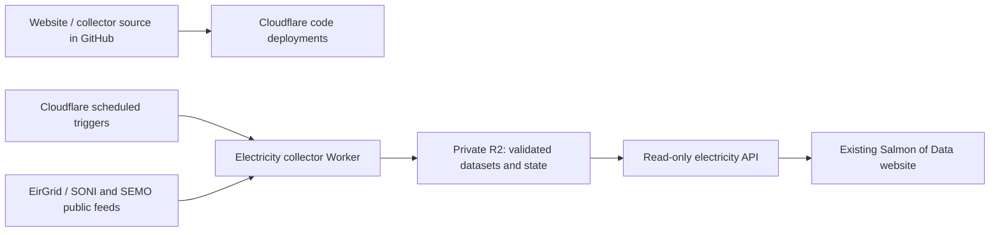

# Northern Ireland electricity: main-site agent handoff

Prepared 31 October 2026. This is the proposed web architecture and implementation brief; cloud collection has not yet been deployed. Mac collection is installed and enabled.

## Start here

The user wants the standalone electricity dashboard integrated into the existing Salmon of Data website, with current readings refreshed every 15 minutes and daily historical data / derived metrics refreshed automatically. Keep the existing minimalist design, source definitions and attribution.

Local paths:

- Main website repository: `/Volumes/External SSD/Projects/salmon-2026/el-nino-tracker` (despite the folder name, `package.json` identifies `salmon-of-data`).
- Prototype source: `/Volumes/External SSD/Projects/NI electricity/dashboard`.
- Required collector helpers: `/Volumes/External SSD/Projects/NI electricity/research/dispatch_proxy/{analyse.py,collect.py,snapshot.py}`.
- Active Mac copy: `~/Library/Application Support/SalmonOfDataElectricity/`, containing `dashboard/` and `research/dispatch_proxy/`.
- Local prototype: `http://127.0.0.1:8765/#overview` and `#trends`.

Read `SCHEDULING.md` and `HISTORY.md` in the prototype. The main repository's `README.md` and `EDITING.md` describe the existing app. Some old README wording says no publication has occurred; the user's current statement takes precedence: the website is already published on Cloudflare through GitHub.

Observed main-site setup: Vinext / React / TypeScript; `next.config.ts` uses `output: 'export'`; `wrangler.static.jsonc` defines the `salmon-of-data` static-assets Worker serving `dist/client`. Preserve this deployment. Confirm its actual Cloudflare build configuration and production domain before adding resources. Do not assume it is a Pages project or that static app route handlers execute on a server.

## Proposed web pattern

Keep website code deployments through the existing GitHub → Cloudflare path. Add a **separate scheduled electricity collector Worker and private R2 storage** in the same Cloudflare account. Visitors read small published JSON datasets through a read-only data API. Data updates write to storage without Git commits or website rebuilds.



Suggested repository layout: integrate the UI under the site's existing dashboards structure, e.g. `/dashboards/ni-electricity/`, and put the collector in `workers/ni-electricity/` with its own Wrangler configuration. Verify navigation conventions first. Do not change unrelated trackers or their frozen forecast definitions.

Suggested resources: Worker `ni-electricity-data`, production bucket `ni-electricity-prod`, binding `ELECTRICITY_DATA`, and separate preview resources. These names are proposals, not existing resources. Keep preview jobs from writing production data.

Prefer a same-origin `/api/electricity/*` Worker route if it fits the existing domain routing. Otherwise use a dedicated data subdomain and configure CORS for the published read-only data. This is independent of the static site; adding a static `app/api` directory alone is insufficient.

Cloudflare Workers supports scheduled handlers in JavaScript/TypeScript and Python, but the current Python collector is a desktop program using subprocesses, local files, fcntl locks and a persistent cache. It is **not deployable unchanged** to Workers. Adapt it to the Workers runtime, storage bindings and async fetch. TypeScript fits the main site's stack, but preserve the Python calculation semantics and test fixtures. Choose a compatible XML parser rather than assuming browser DOMParser is available.

## Schedules and limits

- Live snapshot: every 15 minutes; suggested UTC cron `2,17,32,47 * * * *` to allow a small publication offset.
- History: once per UK calendar day after 07:10 Europe/London, with retries if collection fails. One approach is `10 * * * *` plus a persistent UK-date / local-time due check; this handles BST without rewriting cron seasonally.
- The browser checks a small manifest every minute while visible and when revisited. Fetch large history only when its version changes. Preserve chosen view, source, resolution, year filters and open unit details.

[Cron Triggers use UTC](https://developers.cloudflare.com/workers/configuration/cron-triggers/). The hourly daily-job trigger should exit quickly after that day's successful run. Local Wrangler development does not automatically execute cron schedules: use its supported scheduled-handler test facility or a local timer.

Budget initially for Workers Paid, **$5 USD/month account minimum plus applicable usage**, checking whether the account already has it. R2 has a free usage allowance; costs depend on stored history, requests and traffic. This is a planning estimate, not a measured cloud bill. [Workers pricing](https://developers.cloudflare.com/workers/platform/pricing/), [R2 pricing](https://developers.cloudflare.com/r2/pricing/).

Benchmark CPU, memory, subrequests and wall time in the deployed runtime before enabling production schedules. Current limits list 10 ms CPU per Free cron invocation; Paid cron has 30 seconds CPU for intervals below one hour and 15 minutes at hourly-or-longer intervals, with 128 MB memory. Network waits and CPU are different. The Mac's roughly 18–60 second wall times do not prove a Workers fit. [Limits](https://developers.cloudflare.com/workers/platform/limits/).

Use incremental state and bounded requests. Do not replay the entire historical archive every quarter hour. Seed the existing historical dataset once, refresh recent grid windows daily and preserve older accepted data. Long initial backfills may need a separate controlled job.

If upstream access or processing cannot be made reliable within Workers limits, a documented fallback is Python in GitHub Actions uploading to R2, with the same website/API contract. This needs fewer collector changes, but scheduled Actions can be delayed or dropped, and public repository schedules disable after 60 days of inactivity; it is an approximate 15-minute schedule. Private-repository compute has an allowance and possible charges. [GitHub scheduling](https://docs.github.com/en/actions/reference/workflows-and-actions/events-that-trigger-workflows#schedule), [billing](https://docs.github.com/en/billing/concepts/product-billing/github-actions).

## Publish and serve data safely

Use immutable versioned datasets plus small current pointers:

| Purpose | Suggested private R2 key |
|---|---|
| Validated snapshot | `published/snapshot/<version>.json` |
| Validated daily history | `published/history/<version>.json` |
| Independent current pointers | `pointers/snapshot.json`, `pointers/history.json` |
| Collection health | `health/snapshot.json`, `health/history.json` |
| Collector state / source archive | `state/*`, `archive/*` |

Write and validate a dataset before moving its pointer. Retain the last valid version on failures. Keep per-dataset pointers independent so overlapping live and daily jobs cannot overwrite each other's manifest state. A read-only manifest endpoint can combine pointers and health. Serialize writers per dataset, e.g. with a Durable Object or a transactional lease; local filesystem locks cannot coordinate cloud invocations.

The API should expose only the manifest and published datasets through explicit GET/HEAD handlers. Keep state, raw reports, internal logs and write operations private. Use short caching / revalidation for manifests and current pointers, and long immutable caching for versioned objects. Avoid cached stale pointers masking successful updates.

Suggested manifest compatibility with the prototype: `snapshot.version`, `snapshot.dataTime`, `snapshot.lastSuccess`, `snapshot.ok`; equivalent history fields; environment and intended cadences. Inspect `dist/auto-refresh.js` for the current local contract, replacing its Mac-specific health wording for the web. Distinguish actual observation time from retrieval/build time. A successful fetch of an old source reading must not imply fresh observations.

Seed from the active Mac copy with `python3 schedule_mac.py sync-data` in the prototype first. Treat the bundled last reading as fallback data until the first cloud job passes validation. Include source provenance and explicit capacity assumptions in the cloud metadata.

## Reuse these files and semantics

- UI / map: `dist/index.html`, `dist/styles.css`, `dist/app.js`, `dist/assets/map-data.js`.
- Historical UI, aggregation, downloads: `dist/trends.js`, `dist/history-model.js`.
- Current data boundary: `dist/assets/snapshot.json`; history: `dist/assets/history.json`.
- Browser version polling: `dist/auto-refresh.js`.
- Collection: `refresh_snapshot.py`, `refresh_history.py` and the research helpers listed above.
- Validation: `test_history.py`, `test_scheduling.py`, `test_history_model.cjs`, `test_auto_refresh.cjs`, `test_overview.cjs`.

Important calculation rules:

1. Match demand, generation, wind, solar and Moyle to a common actual observation time. Use only actual fields; never replace missing values with zero. Public endpoints can return empty or stale results for valid windows: preserve bounded alternate-window queries, field validation, retries and provenance.
2. North-South estimate = demand − NI generation − signed Moyle flow. Positive is import into NI; negative is export. Labels and arrows must agree in both directions. NI generation excludes imports. The top summary combines both flows: positive → “Net imports” with a share of demand; negative → “Net exports” with an absolute MW amount and no demand-share line; zero → “Net flow”, 0 MW and no share. Retain signed values in the underlying data and definition arithmetic.
3. Overview stations are last-published dispatch-target proxies, not metered real-time output. Carry forward valid state from published meter seeds / subsequent instructions; unknown or expired state is not zero. Maintain per-unit provenance, availability and technical parameters. A zero target is not proof of an outage.
4. Overview Other = generation − wind − solar − station proxies. It is a signed balancing amount. The supply bar shows positive contributions; exports and negative balances are identified in the legend.
5. Trends has Generation (Wind, Solar, Non-renewables and other, Total NI generation), a separate Demand view and Interconnectors. It omits individual stations. Historical `otherNI` = generation − wind − solar, including all non-wind/non-solar generation, including any other renewables. It is not purely fossil generation or the overview's balancing Other.
6. Grid daily means require 96 distinct quarter-hour slots; exclude incomplete/conflicting days and today. Preserve actual zero and explicit gaps. Current prototype omits ambiguous/incomplete clock-change days rather than inventing intervals. Reconcile source clock conventions explicitly before changing that rule.
7. Monthly and annual points average accepted daily means; chart points require at least 95% of elapsed-day coverage. The range headline weights days directly. CSV keeps unavailable values blank and includes coverage / eligibility fields. Historical solar and `otherNI` have shorter coverage; do not invent older solar zeros.
8. Wind plus solar percentage uses **demand** as denominator. Preserve source portfolio / rooftop-solar limitations in Definitions.
9. Moyle's 250 MW fault assumption and North-South's 300 MW reference are separately maintained metadata, not inferred from flow. Check their dated source before web launch and show their basis. The reference is not a verified live operating limit.

The historical collector still retains station meter archives internally, although the current Trends interface and CSV omit them. Consider separating that optional archive collection from the seven displayed grid series so a hidden station-feed failure cannot unnecessarily prevent grid-history publication.

## Design, attribution and integration

Preserve the approved cream / ink / teal / salmon appearance, minimalist NI map, simplified Lough Neagh, omitted Lough Erne, plant positions and direction-aware connector cards. Keep explanatory text in Definitions & sources. Use the main site's header, footer and route conventions when integrating; scope styles and handlers so other trackers are unaffected.

The overview has one left-aligned **Supported by EirGrid Group Data** credit at the bottom, linked to the [EirGrid Group Open Data Licence](https://www.smartgriddashboard.com/ni/open-data-license/). Do not restore duplicate credits below the supply bar or the detailed geography attribution beneath the map. Keep Natural Earth's public-domain and DAERA/NIEA OGL map credits in Definitions & sources. Trends, unit details and PNG/SVG exports retain their EirGrid attribution and licence. Include metric definitions and avoid suggesting operator endorsement. CSV metadata / download context should identify the same source and licence without breaking its numeric schema.

When a validated snapshot or history version updates an open page, give the affected visible panels a subtle 900 ms wipe. Do not animate unchanged polls, failed/rejected data, navigation or filter changes. Respect `prefers-reduced-motion`; updates must preserve filters, focus and open station details. The feedback is implemented in `auto-refresh.js` and `styles.css`.

## What Peter needs to enable or provide

1. Confirm the production Cloudflare account, website domain and GitHub repository / production branch. Reuse the existing account and repository connection.
2. Enable Workers Paid if needed for the collector workload. This is separate from a domain's Free/Pro website plan. The user handles any paid-plan checkout.
3. Activate R2 in Cloudflare: Storage & databases → R2 → Overview → complete subscription setup. The user handles that checkout; free monthly usage is available. [R2 setup](https://developers.cloudflare.com/r2/get-started/).
4. Allow the agent to configure the collector Worker, a private production bucket, preview resources, bindings, API route/subdomain, cron schedules and logs in that account. The exact names and routing can be chosen during implementation.
5. Prefer the existing Cloudflare GitHub integration for collector **code deployment** too, with the build root set to the collector directory and the Worker name matching its Wrangler config. [Native Git builds](https://developers.cloudflare.com/workers/ci-cd/builds/).
6. If GitHub Actions is used for deployment instead, enable Actions and add repository/environment secrets `CLOUDFLARE_ACCOUNT_ID` and `CLOUDFLARE_API_TOKEN`. Create a scoped **Edit Cloudflare Workers** token for the relevant account/zone only; store its value directly in Secrets, not chat or source. [Official deployment setup](https://developers.cloudflare.com/workers/ci-cd/external-cicd/github-actions/).
7. Native Workers uses an R2 binding and does not require S3 keys in the browser. If the Python/Actions collection fallback is chosen, create bucket-scoped Object Read & Write R2 credentials and store their access key / secret as Actions secrets. This is an alternate setup, not an extra requirement for the native Worker path. [R2 bindings](https://developers.cloudflare.com/r2/api/workers/workers-api-usage/), [S3 credentials](https://developers.cloudflare.com/r2/api/tokens/).
8. Choose an operational failure-notification destination and configure it during launch. Logs should distinguish stale source data from collector failures; choose explicit stale thresholds. No upstream API account/key is currently required for the public EirGrid/SONI or SEMO sources.

## Implementation order and acceptance

1. Integrate the approved dashboard with bundled validated data; preserve existing site routes and checks.
2. Implement cloud collection/storage and compare a fresh cloud snapshot against the Python collector at the same source timestamp. Verify station state, signed imports/exports, capacity metadata and arithmetic.
3. Seed historical data, run the daily job and compare means, gaps, coverage, derived categories and CSV with the existing model.
4. Test missing/empty/late feeds, incomplete days, clock changes, duplicate/overlapping jobs, backwards timestamps, API caching and persistence after restart. Prove last-good data survives failures.
5. Exercise deployed scheduled triggers, logs and browser polling. A changed manifest must update an open chart without resetting filters, with the subtle wipe only on affected visible panels and suppressed for reduced motion; image exports must retain credits. Check desktop, mobile, keyboard access, import/export/zero summaries and unit dialogs.
6. Wire collector code deployment to the existing GitHub flow, enable production schedules after validation, and confirm fresh published data without a site rebuild. Preview schedules/resources must not affect production.
7. Once web collection is verified, Peter can disable local collection using the command below. Publishing alone does not disable Mac jobs. Keep the old working copy for rollback.

```sh
python3 "/Volumes/External SSD/Projects/NI electricity/dashboard/schedule_mac.py" stop-updates
```

`start-updates` reverses that action. `uninstall` removes all three Mac agents, including the preview server. `status` reports current local health. Disabling Mac collection does not stop the cloud collector; their schedules are independent.

No cloud resources, credentials, repository pushes or deployed-site changes were made in the documentation handoff task. Existing Mac collection remains enabled.
